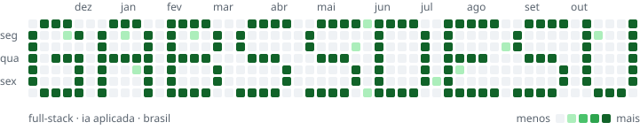
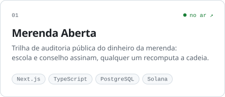
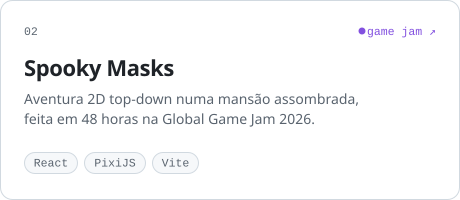
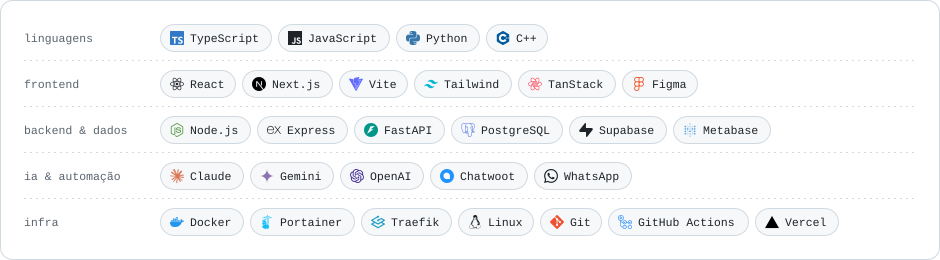

<picture>
  <source media="(prefers-color-scheme: dark)" srcset="assets/graph-dark.svg">
  
</picture>

 

### oi, gabriel aqui.

dev **full-stack** no brasil, técnico em desenvolvimento de sistemas pelo if sudeste mg e estudante de sistemas de informação na ufjf.

no dia a dia eu coloco em produção **crms, agentes de ia e automações de atendimento**, do schema do banco ao deploy no servidor.

- **ponta a ponta**: banco, api, interface e deploy. a feature sai do ticket e chega na produção sem passar por três pessoas.
- **ia que atende gente de verdade**: agentes ligados ao whatsapp e ao crm, conversando com cliente real, não só demo.
- **automação**: disparos, rpa e integrações que tiram o trabalho repetitivo das costas de alguém.
- **infra própria**: docker, traefik e portainer em vps, com métrica no metabase pra saber se valeu a pena.

 

### projetos

<a href="https://merenda-aberta.vercel.app"><picture><source media="(prefers-color-scheme: dark)" srcset="assets/work-merenda-32f33aa-dark.svg"></picture></a>&nbsp;<a href="https://github.com/Gabssdesu/ggjam2026"><picture><source media="(prefers-color-scheme: dark)" srcset="assets/work-spooky-158ae76-dark.svg"></picture></a>

a maior parte do que eu faço vive em 45+ repositórios privados: crms multi-tenant, disparadores de whatsapp, agentes de ia e rpa. dá pra mostrar o código numa call.

 

### stack

<picture><source media="(prefers-color-scheme: dark)" srcset="assets/stack-08dd7b0-dark.svg"></picture>

 

### contato

[github](https://github.com/Gabssdesu)

 

o gráfico lá de cima é desenhado, não conquistado. <a href="scripts/build.mjs">veja como</a>.
